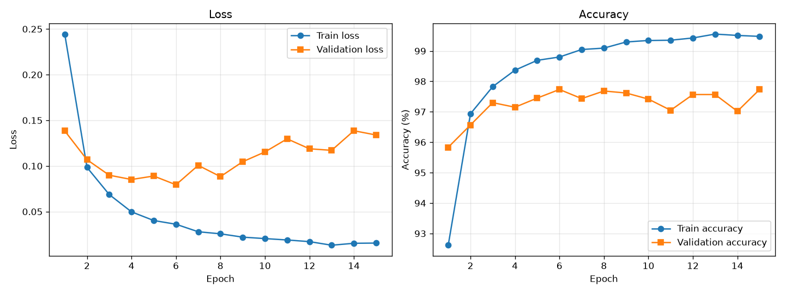
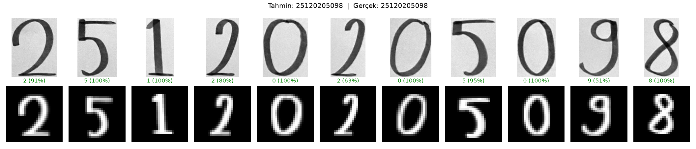

# MNIST ile MLP Tabanlı El Yazısı Rakam Tanıma

**Öğrenci:** Zeynep Aslı Çakmak — **Numara:** 25120205098

## Çalıştırma

```bash
pip install -r requirements.txt
python train.py
python predict_own.py --image my_digits/numara.jpg --number 25120205098
```

## Veri Ayrımı

| Küme       | Görüntü sayısı |
| ---------- | -------------- |
| Train      | 54.000         |
| Validation | 6.000          |
| Test       | 10.000         |

Train ve validation, MNIST eğitim setinden ayrıldı. Test seti yalnızca eğitim bittikten sonra bir kez kullanıldı.

## Deney 1 – Temel MLP Modeli

**Mimari:** 784 → 256 → ReLU → 128 → ReLU → 10

| Hiperparametre  | Değer            |
| --------------- | ---------------- |
| Gizli katmanlar | 2 (256, 128)     |
| Aktivasyon      | ReLU             |
| Loss            | CrossEntropyLoss |
| Optimizer       | Adam             |
| Learning rate   | 0.001            |
| Batch size      | 64               |
| Epoch           | 15               |

| Sonuç               | Değer    |
| ------------------- | -------- |
| Training loss       | 0.0156   |
| Validation loss     | 0.1339   |
| Training accuracy   | %99.48   |
| Validation accuracy | %97.73   |
| Test accuracy       | %97.92   |
| Eğitim süresi       | 294.2 sn |



## Kendi El Yazısı

Görüntüler gri tonlamaya çevrildi, renkleri ters çevrildi (siyah arka plan, beyaz rakam), 28×28 piksele dönüştürüldü ve eğitimdeki ile aynı normalizasyon uygulandı.



**Gerçek:** 25120205098 — **Tahmin:** 25120205098 — **Doğruluk:** 11/11

## Genel Değerlendirme

Model MNIST test verisinde %97.92 doğruluk elde etti. Eğitim sırasında training loss sürekli düşerken validation loss 6. epoch'tan sonra artmaya başladı. Bundan modelin bu noktadan sonra eğitim verisini ezberlemeye, yani overfitting yapmaya başladığını anladım.

Kendi el yazımla yazdığım okul numaramdaki 11 rakamın hepsini model doğru tahmin etti. Ama her rakamdan aynı derecede emin değildi. 0, 1, 5 ve 8 gibi MNIST'tekilere benzeyen rakamlarda %95-100 arası emin olurken, benim farklı yazdığım 9 rakamında %50.5, bir 2 rakamında da %62.8 güvenle tahmin yaptı. Buradan, modelin eğitildiği verilere benzemeyen yazılarda zorlandığını gördüm. Yani eğitim verisi ile gerçek hayattaki veri farklı olduğunda (distribution shift) modelin başarısı etkileniyor. Ayrıca fotoğrafları MNIST formatına (siyah arka plan, beyaz rakam, 28×28 boyut) çevirmeseydim sonuçların çok daha kötü olacağını düşünüyorum.
